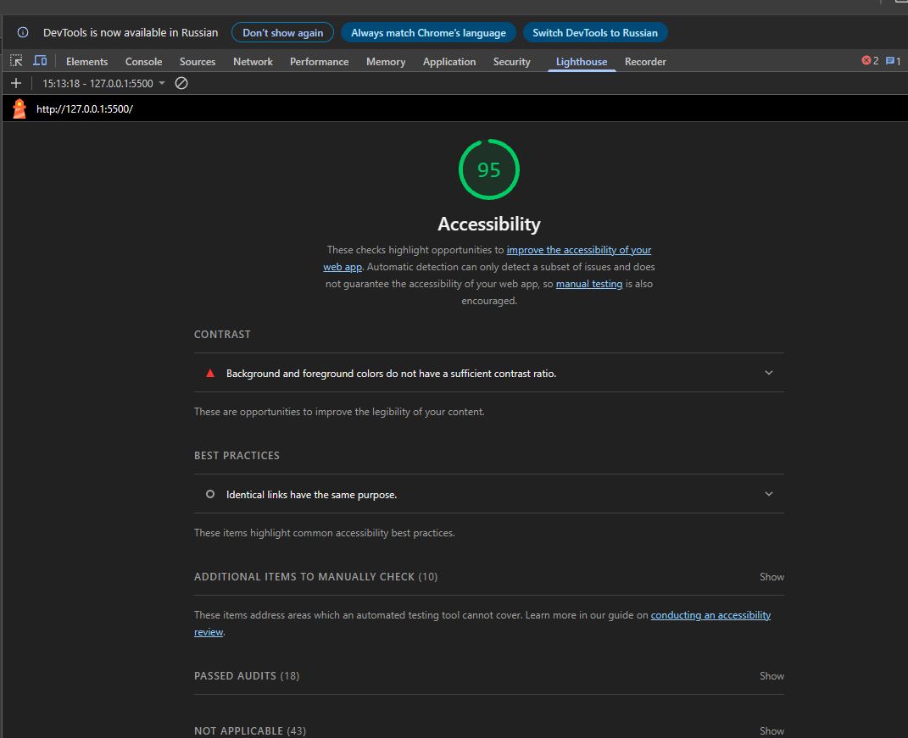
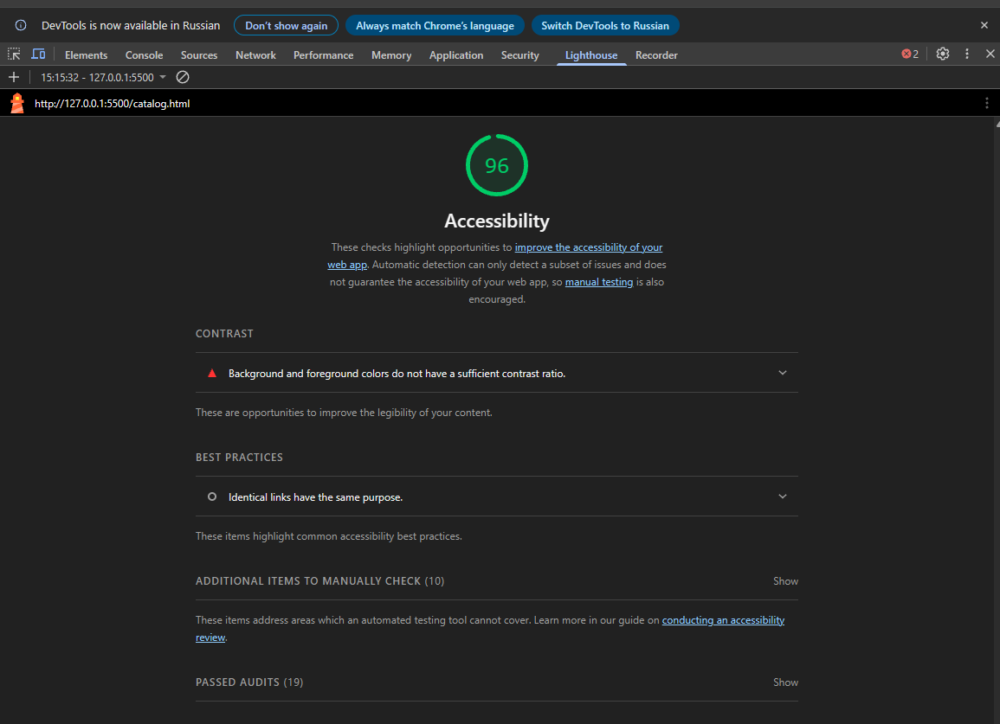
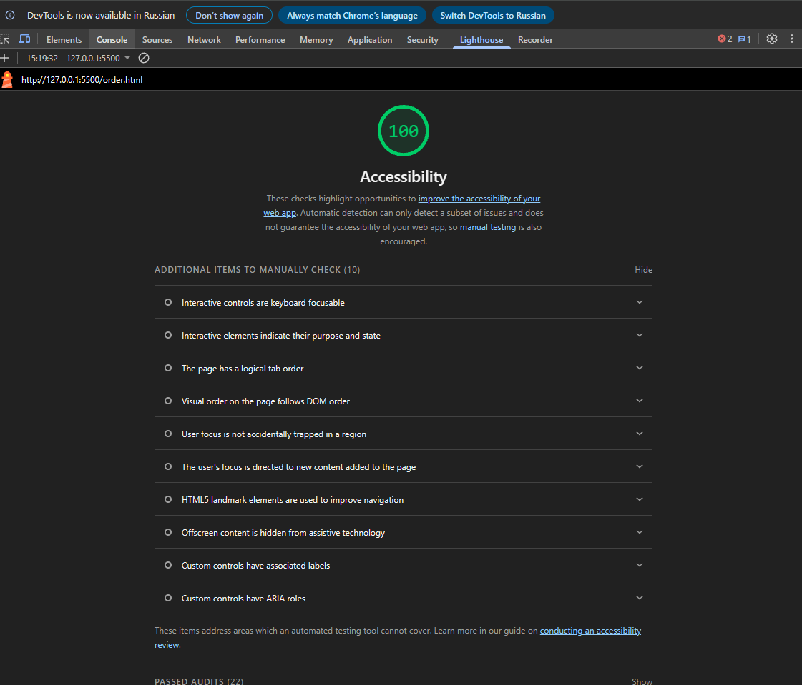
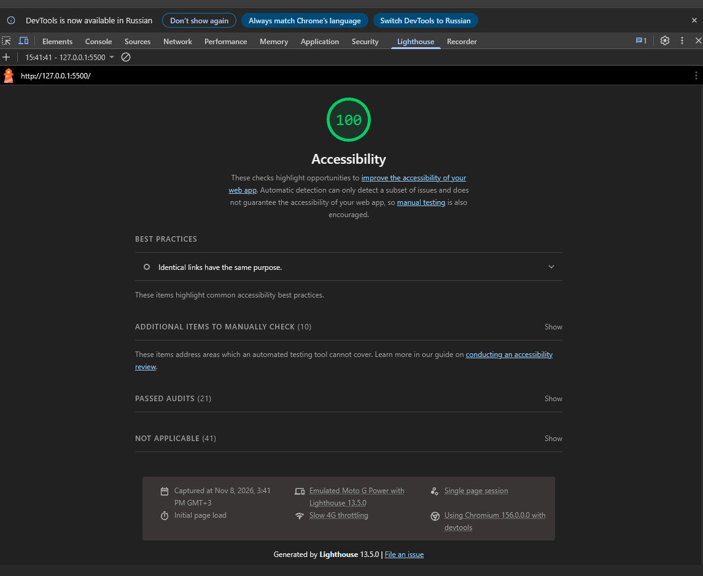
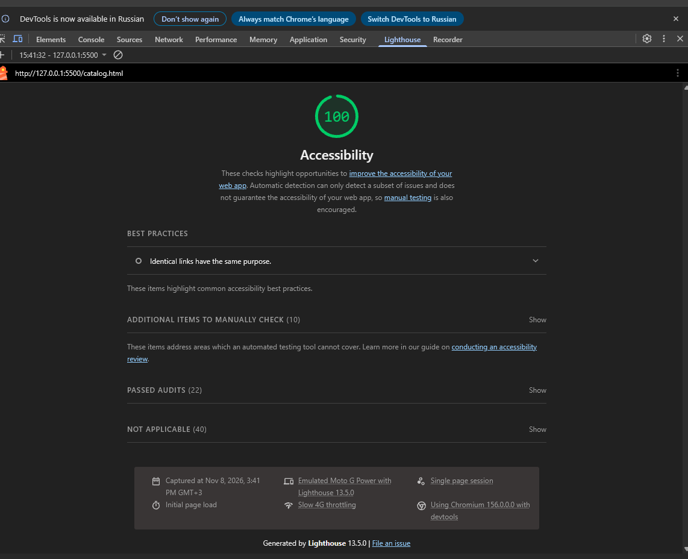
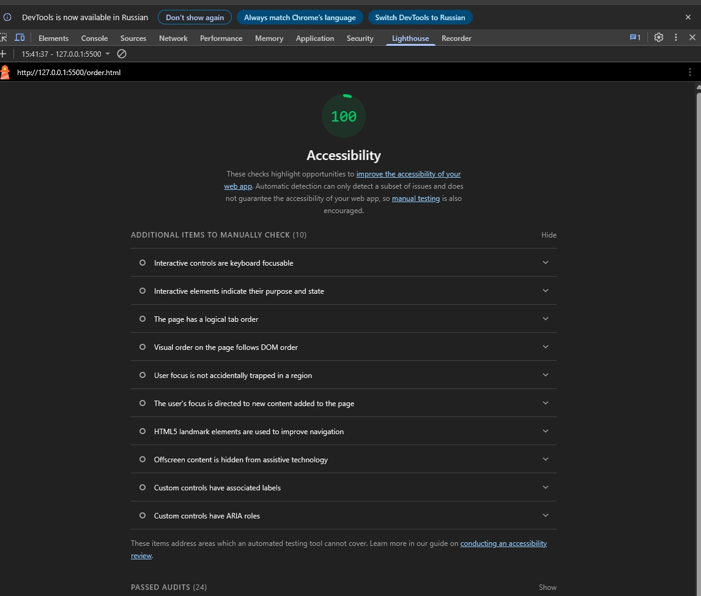

# Контрольная работа №3

Тема: «Адаптивная вёрстка и доступность многостраничного HTML/CSS-сайта».

Дисциплина «Фронтенд и бэкенд разработка».

## Автор

ФИО: Трофименко Дмитрий Константинович
Группа: ЭФБО-08-25

## Ссылки

- GitHub Pages: https://rubynich.github.io/kr3-responsive-shop/

## Описание

Проект представляет собой адаптивную версию многостраничного HTML/CSS-сайта учебного интернет-магазина
игровой периферии (клавиатуры, мыши, гарнитуры). Основа перенесена из контрольной работы №1
(`kr1-html-css-shop`), Bootstrap и другие CSS-фреймворки не используются.

## Практическая работа №12

Выполнено:

- создан отдельный репозиторий `kr3-responsive-shop`;
- перенесена основа проекта КР №1;
- добавлен файл `css/responsive.css`, подключён на всех 7 страницах после `style.css`;
- на всех страницах есть `<meta name="viewport" content="width=device-width, initial-scale=1.0">`;
- применён подход Mobile First: базовые правила для телефона, расширения через `min-width`;
- адаптирована навигация (колонка на телефоне, строка от 768px) и шапка (sticky только от 768px);
- адаптирован hero-блок (одна колонка, от 900px две колонки);
- адаптирована сетка карточек (1 → 2 → 3 колонки);
- адаптирован каталог: фильтр над товарами на телефоне, боковой sticky-фильтр от 1024px;
- добавлены responsive images: `srcset` + `sizes` у карточек, `<picture>` у hero и страниц товаров;
- адаптирована форма заявки (одна колонка → две колонки, поля от 44px высотой);
- адаптирована таблица характеристик (контейнер `.table-wrapper` с горизонтальной прокруткой);
- адаптировано модальное окно `<dialog>` и фиксированные элементы («Наверх», уведомление);
- выполнена проверка через DevTools.

## Практическая работа №13

Тема: «A11y-аудит и обеспечение доступности. Использование Lighthouse и анализ проблем доступности».

Выполнено:

- проверена семантическая структура страниц (на каждой странице один `h1`, порядок заголовков h1 → h2 → h3, есть `header`, `nav`, `main`, `footer`);
- добавлена ссылка пропуска `.skip-link` к основному содержимому на всех 7 страницах (`<main id="main">`);
- проверена навигация с клавиатуры: меню, карточки, фильтры, форма, модальное окно, кнопка «Наверх»;
- добавлен общий видимый фокус `:focus-visible` (outline 3px);
- проверены изображения и alt-описания (у всех смысловых изображений alt непустой, декоративных нет);
- проверены формы и связанные `label for` / `id`; подсказка формата телефона связана с полем через `aria-describedby`;
- проверены кнопки и ссылки (действия — `button`, переходы — `a`);
- исправлена контрастность отдельных элементов;
- проверено модальное окно `<dialog>`;
- проверена таблица характеристик (`caption`, `th scope`, контейнер `.table-wrapper`);
- выполнен Lighthouse-аудит;
- сохранены Lighthouse-отчёты (скриншоты до и после) в папке `lighthouse/`;
- исправлены найденные проблемы доступности.

## Lighthouse

Проверены страницы:

- `index.html`;
- `catalog.html`;
- `order.html`.

Категория: Accessibility, режим Mobile (Lighthouse 13.5.0, Chromium 156). Проверка выполнена на локальном сервере
(Live Server) до и после исправлений. Скриншоты отчётов сохранены в папке `lighthouse/`.

| Страница | До исправлений | После исправлений |
| --- | --- | --- |
| `index.html` | 95 | 100 |
| `catalog.html` | 96 | 100 |
| `order.html` | 100 | 100 |

До исправлений Lighthouse нашёл на `index.html` и `catalog.html` недостаточный контраст (бейдж «Новинка») и
предупреждение «Identical links have the same purpose» (одинаковые ссылки «Подробнее» без различимого названия).
Оба замечания разобраны в разделе «Исправления доступности». После исправлений ошибок в разделе Accessibility нет;
пункты «Additional items to manually check» проверены вручную (клавиатура, порядок Tab, фокус, ориентиры страницы).

### Скриншоты до исправлений





### Скриншоты после исправлений





## Исправления доступности

| Проблема | Исправление |
| --- | --- |
| Не было ссылки пропуска к основному содержимому | Добавлена `.skip-link` в начале `body`, у `main` добавлен `id="main"`; ссылка скрыта за экраном и появляется при фокусе (не `display: none`) |
| Фокус был 2px и задан только для отдельных элементов | Добавлено общее правило `:focus-visible` (outline 3px, offset 3px), остальные правила приведены к 3px |
| Белый текст на зелёном бейдже «Новинка» имел контраст 4.46:1 (нужно ≥ 4.5:1) | `--color-success` изменён с `#168a2f` на `#12792a` (контраст 5.5:1) |
| Границы полей формы `#ddd` имели контраст 1.36:1 с фоном | Для полей введена переменная `--color-border-strong: #767676` (контраст 4.5:1) |
| Текущая страница в хлебных крошках не была помечена | Добавлен `aria-current="page"` |
| Подсказка формата телефона не была связана с полем | Добавлены `id` подсказки и `aria-describedby`; JS сохраняет эту связь при показе ошибки |
| Сообщения об ошибках формы не озвучивались вспомогательными технологиями | Элементу ошибки добавлен `role="alert"` |
| В форме модального окна не было обозначения обязательных полей | Добавлены звёздочки и пояснение к ним |
| Lighthouse: «Identical links have the same purpose» (одинаковые ссылки «Подробнее» ведут на разные страницы) | У ссылок «Подробнее» и «Оставить заявку» и кнопок «Заказать» добавлен `aria-label` с названием товара (видимый текст входит в имя) |
| Lighthouse: «Background and foreground colors do not have a sufficient contrast ratio» на index.html и catalog.html (95 и 96 баллов) | Исправлен контраст бейджа «Новинка» (см. выше) |
| У ссылки «Наверх» дублировался `aria-label` с видимым текстом | `aria-label` удалён, имя берётся из текста |
| Плавная прокрутка не учитывала настройки пользователя | Добавлен `@media (prefers-reduced-motion: reduce)` |

ARIA использована только там, где нужна: `aria-label` у нескольких `nav`, `aria-current="page"`,
`aria-labelledby` у `dialog`, `aria-invalid` и `aria-describedby` у полей с ошибкой.

## Практическая работа №14. Финальная проверка КР №3

Проверено перед сдачей:

- структура проекта соответствует требованиям (5 обязательных страниц, две страницы товаров, `css/`, `js/`, `images/`, `lighthouse/`);
- на всех 7 страницах подключены `css/style.css` и затем `css/responsive.css`, в `head` есть `meta viewport`;
- адаптивность проверена в DevTools на ширинах 360px, 430px, 768px, 1024px и 1440px, горизонтального скролла страницы нет;
- responsive images: `srcset` + `sizes` у карточек, `<picture>` у hero и страниц товаров;
- формы адаптивны (одна колонка на телефоне, две от 640px), таблица характеристик находится в `.table-wrapper`;
- на странице `contacts.html` добавлена форма обратной связи (поля с `label`, проверка тем же `main.js`, что и форма заявки);
- мобильное меню и карточный вид таблицы проверены в браузере на 360px и 1024px (открытие, закрытие по `Escape`, возврат фокуса, отсутствие горизонтального скролла);
- доступность и Lighthouse: 100 баллов Accessibility на `index.html`, `catalog.html`, `order.html`, скриншоты в `lighthouse/`.

## Самостоятельные доработки

- Mobile First: базовые стили для телефона, расширение через `min-width` (640, 768, 900, 1024, 1200px).
- Мобильная навигация: на телефоне меню скрыто за кнопкой «Меню» (`aria-expanded`, `aria-controls`), иконка
  превращается в крестик, меню закрывается по `Escape` (фокус возвращается на кнопку), по клику на ссылку и по клику
  вне шапки. От 768px кнопка пропадает, меню показано в строку. Без JavaScript меню всегда раскрыто
  (класс `js` ставится скриптом в `head`).
- Таблица характеристик на телефоне (до 640px) показана карточками «параметр — значение», шапка столбцов скрыта
  визуально, но остаётся для скринридеров (`caption`, `th scope` сохранены). От 640px возвращается обычная таблица;
  `.table-wrapper` с прокруткой остаётся страховкой.
- Каталог: фильтр над товарами на телефоне, боковой `sticky`-фильтр от 1024px, 1 → 2 → 3 колонки карточек.
- Responsive images: три варианта hero через `<picture>`, `srcset` (320w/480w/оригинал) с рассчитанным `sizes`,
  WebP с PNG-запасом на страницах товаров, `loading="lazy"` и `fetchpriority="high"` для hero.
- Доступность: `skip-link`, общий `:focus-visible` 3px, исправление контраста бейджа и границ полей,
  `aria-current`, уникальные имена одинаковых ссылок («Подробнее: …») через `aria-label`,
  связь подсказок и ошибок с полями (`aria-describedby`, `role="alert"`), `prefers-reduced-motion`.
- Lighthouse: отчёты сняты до и после исправлений (95 / 96 / 100 → 100 / 100 / 100), найденные замечания устранены.
- Форма в модальном окне `<dialog>` и формы на страницах заявки и контактов проверяются одним скриптом с текстами ошибок на русском.
- Проект опубликован через GitHub Pages (ссылка в начале README).

## Брейкпоинты

| Ширина | Что меняется |
| --- | --- |
| до 640px | всё в одну колонку, меню за кнопкой «Меню», шапка не липкая, кнопки на всю ширину, таблица карточками |
| от 640px | карточки в 2 колонки, форма заявки в 2 колонки, фильтры в 2 колонки, обычная таблица |
| от 768px | меню в строку (кнопка «Меню» скрыта), шапка `sticky`, карточка товара в 2 колонки, увеличенные отступы |
| от 900px | hero и страница заявки в 2 колонки (текст + картинка / форма + aside) |
| от 1024px | каталог: боковой sticky-фильтр + 2 колонки; главная: 3 колонки карточек |
| от 1200px | каталог: 3 колонки карточек |

## Адаптивные решения

- **Контейнеры.** Ширину ограничивают существующие `max-width: var(--container-width)` и `margin: 0 auto`,
  боковые поля задаёт `.site-main` (16px на телефоне, 24px от 768px). Отдельный `.container` не добавлялся,
  чтобы не дублировать отступы.
- **Сетки.** `grid-template-columns: minmax(0, 1fr)` и `repeat(n, minmax(0, 1fr))`: `minmax(0, …)` не даёт длинному
  содержимому растягивать колонки. У заголовков и описаний карточек `overflow-wrap: anywhere`.
- **Изображения.** Глобально `max-width: 100%; height: auto`. У карточек `aspect-ratio: 4 / 3` и
  `object-fit: contain`: товар виден целиком, без обрезки (`cover` обрезал бы клавиатуры и мыши).
  У всех `` указаны `width` и `height`, чтобы страница не «прыгала» при загрузке.
- **Таблица.** До 640px строки таблицы превращаются в карточки (`display: block` у `table`, `tr`, `th`, `td`),
  от 640px возвращается обычная таблица с рамками. Контейнер `.table-wrapper` с `overflow-x: auto` защищает
  страницу, если характеристик станет больше или текст длиннее.
- **Формы.** `min-height: 44px` и `font-size: 16px` у полей (iOS не увеличивает страницу при фокусе), чекбокс 24px,
  кнопки на телефоне друг под другом. Сетка из двух колонок применяется только к форме на `order.html`,
  модальное окно остаётся в одну колонку.
- **Фиксированные элементы.** Уведомление на телефоне поднято над кнопкой «Наверх», чтобы они не перекрывались.
  Отступ `scroll-margin-top` под шапкой на телефоне уменьшен, так как шапка там не липкая.

## Responsive images

| Где | Что использовано |
| --- | --- |
| Hero на главной | `<picture>` с тремя `<source media>`: `hero-desktop.jpg` (от 1200px), `hero-tablet.jpg` (от 768px), `hero-mobile.jpg` (запасной ``) |
| Карточки на главной и в каталоге (товары 1, 2, 5, 6) | `srcset` с версиями 320w, 480w и оригиналом + `sizes`, рассчитанный по реальной ширине карточки в сетке |
| Страницы товаров | `<picture>` с WebP и PNG-запасным вариантом |
| Карточки 3 и 4 | исходные файлы 307px и 320px: уменьшать нечего, поэтому обычный `` |

Значения `sizes` соответствуют раскладке: например, в каталоге `(max-width: 639px) calc(100vw - 66px)`
(одна колонка: ширина экрана минус отступы страницы и карточки), `calc(50vw - 66px)` (две колонки),
`30vw` (две колонки рядом с фильтром), `220px` (три колонки при максимальной ширине контейнера).
Изображения ниже первого экрана имеют `loading="lazy"`, hero-картинка загружается сразу (`fetchpriority="high"`).

## Проверенные ширины

- 360px;
- 430px;
- 768px;
- 1024px;
- 1440px.

На всех страницах на этих ширинах нет горизонтального скролла страницы. Во вкладке Network на 360px (DPR 1)
загружаются `hero-mobile.jpg` и версии карточек `*-320.png`, на 1440px — `hero-desktop.jpg`.

## Структура проекта

```text
kr3-responsive-shop/
├── index.html
├── catalog.html
├── product.html
├── product-2.html
├── product-3.html
├── order.html
├── contacts.html
├── css/
│   ├── style.css          базовые стили (из КР №1)
│   └── responsive.css     адаптивные стили (Mobile First)
├── js/
│   └── main.js            модальное окно, проверка форм (заявка, контакты), уведомление
├── images/                фото товаров, их уменьшенные версии, WebP и hero-картинки
├── lighthouse/            скриншоты Lighthouse до и после исправлений
├── README.md
└── .gitignore
```

## История выполнения

- Практическая работа 12: создан репозиторий КР №3, добавлен `responsive.css`, адаптированы навигация, hero,
  сетка карточек, каталог, изображения, форма и таблица.
- Практическая работа 13: проведён A11y-аудит, добавлены skip-link и общий видимый фокус, исправлены контраст,
  связи полей формы с подсказками и ошибками, выполнен Lighthouse-аудит, отчёт сохранён в `lighthouse/`.
- Практическая работа 14: финальная проверка КР №3 по чек-листу, добавлена форма обратной связи на `contacts.html`,
  дополнен README (самостоятельные доработки, итоги проверки).
- Практическая работа 14 (доработки): мобильное меню с кнопкой «Меню» и карточный вид таблицы характеристик на телефоне.
